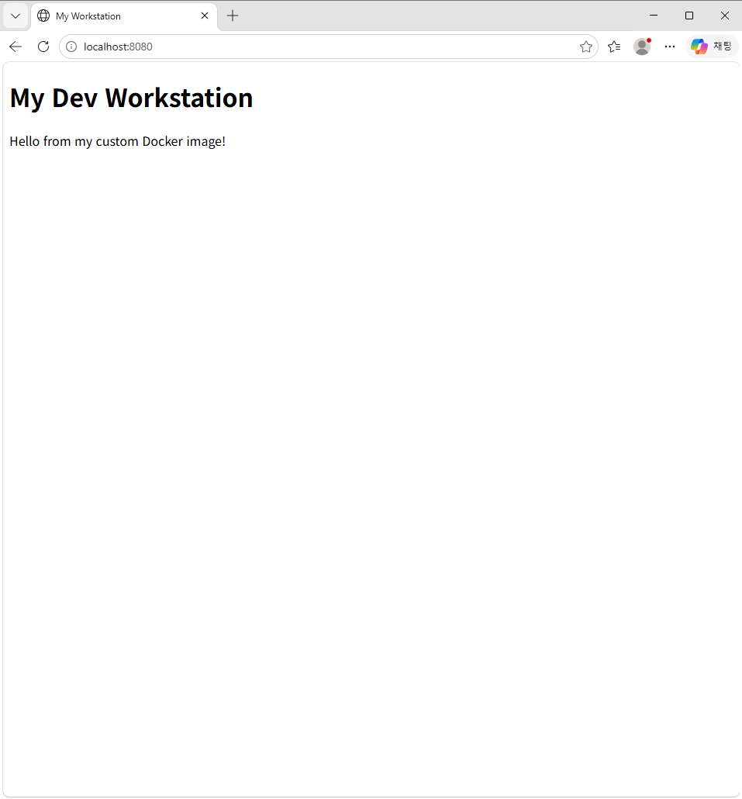
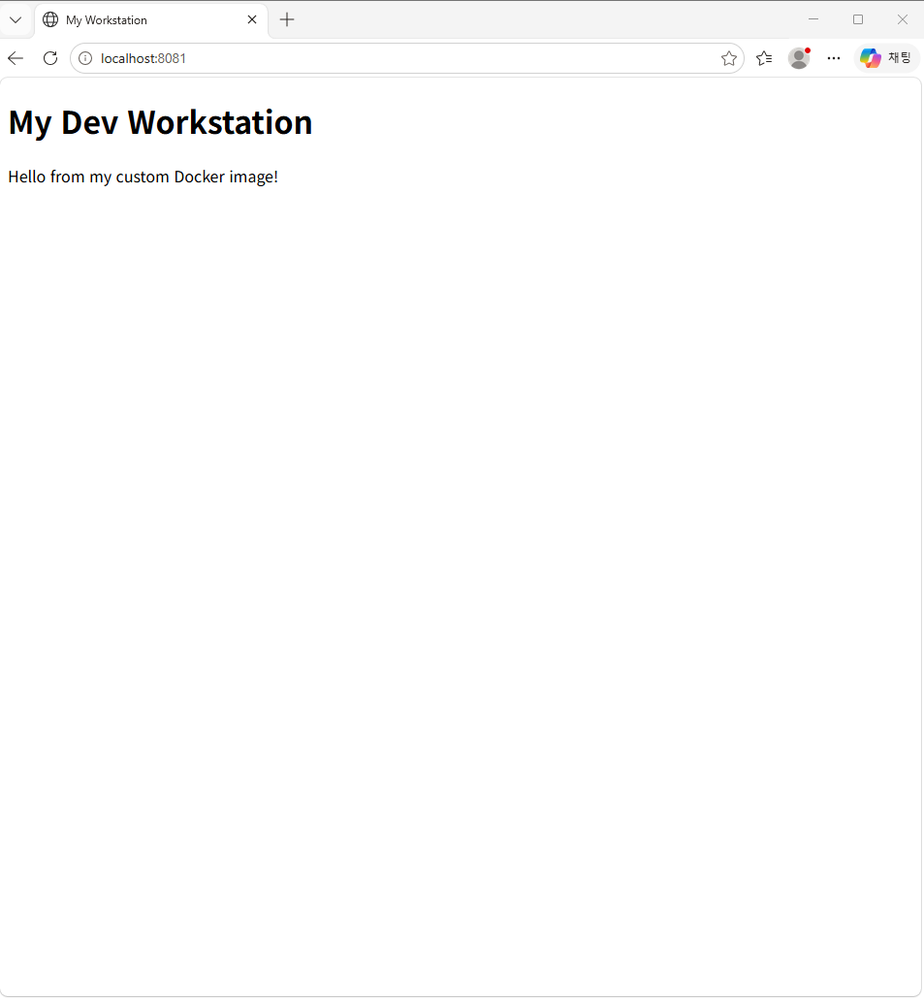
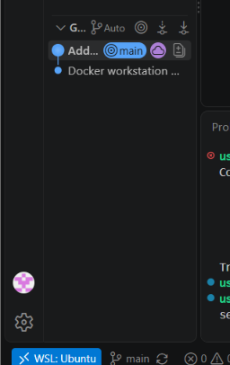
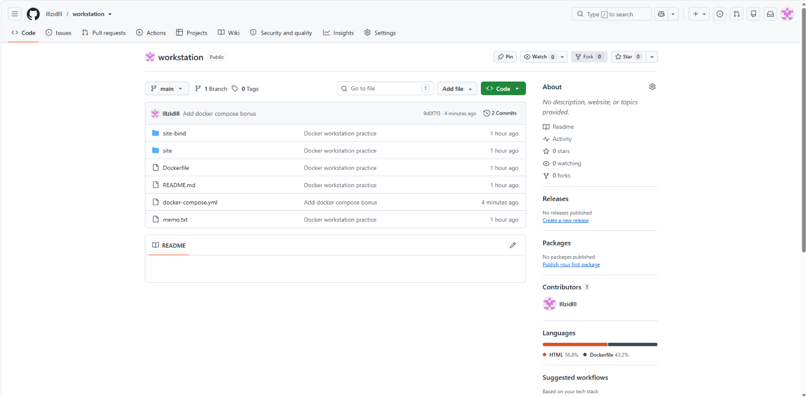

# 개발 환경 구축

## 1. 실행환경

- OS: Windows 11 + WSL2
- Linux: Ubuntu 26.04.1 LTS
- Shell: bash
- Docker: 29.9.2
- Git: 2.53.0

## 2. 수행 로그

### 2-1. WSL 확인 및 진입
PowerShell에서 WSL 설치를 시도했으나 이미 설치되어 있었다.

**① WSL 설치 시도 → 이미 설치되어 있다는 오류**
```bash
PS C:\WINDOWS\system32> wsl --install
파일이 이미 있으므로 만들 수 없습니다.
오류 코드: Wsl/InstallDistro/ERROR_ALREADY_EXISTS
```

**② 설치된 리눅스 목록 확인**
```bash
PS C:\WINDOWS\system32> wsl -l -v
  NAME              STATE           VERSION
* Ubuntu            Stopped         2
  docker-desktop    Stopped         2
```

**③ Ubuntu 진입 후 버전 확인**
```bash
PS C:\WINDOWS\system32> wsl
user@4F-89:/mnt/c/WINDOWS/system32$ lsb_release -a
No LSB modules are available.
Distributor ID: Ubuntu
Description:    Ubuntu 26.04.1 LTS
Release:        26.04
Codename:       resolute
```

- wsl --install : WSL(Windows 안의 리눅스) 설치
- wsl -l -v : 설치된 리눅스 목록과 WSL 버전 확인
- wsl : Ubuntu 리눅스로 진입
- lsb_release -a : 리눅스 종류와 버전 확인

### 2-2. 홈 폴더 이동, 작업 폴더 생성, 이름 변경

**1. 홈 이동 시도 → 오타 (cd 뒤에 띄어쓰기 누락)**
```bash
user@4F-89:/mnt/c/WINDOWS/system32$ cd~
Command 'cd~' not found, did you mean:
  command 'cdb' from deb tinycdb (0.81-2build1)
Try: sudo apt install <deb name>
```

**2. 띄어쓰기 넣어서 홈 이동 → 작업 폴더 생성**
```bash
user@4F-89:/mnt/c/WINDOWS/system32$ cd ~
user@4F-89:~$ mkdir -p codyssy/workstation
```

**3. 폴더 이동 시도 → 오타 (cd 누락)**
```bash
user@4F-89:~$ codyssy/workstation
-bash: codyssy/workstation: Is a directory
```

**4. 폴더 이름 오타 수정 (codyssy → codyssey) 후 이동**
```bash
user@4F-89:~$ mv codyssy codyssey
user@4F-89:~$ cd codyssey/workstation
user@4F-89:~/codyssey/workstation$
```

- cd ~ : 홈 폴더로 이동
- mkdir -p : 폴더 생성
- mv : 원래이름 새이름 : 이름변경 

### 2-3. 빈 파일 생성, 목록 확인(숨김 포함), 현재 위치 

**1. 빈 README 파일 만들고 목록 확인**
```bash
user@4F-89:~/codyssey/workstation$ touch README.md
user@4F-89:~/codyssey/workstation$ ls -la
total 8
drwxr-xr-x 2 user user 4096 Oct 30 16:09 .
drwxr-xr-x 3 user user 4096 Oct 30 16:02 ..
-rw-r--r-- 1 user user    0 Oct 30 16:09 README.md
```

**2. 현재 위치 확인**
```bash
user@4F-89:~/codyssey/workstation$ pwd
/home/user/codyssey/workstation
```

- touch : 빈 파일 만들기 (크기 0)
- ls -la : 숨김 파일까지 자세히 보기
- pwd : 지금 위치를 전체 주소(절대 경로)로 보기

### 2-4. 내용 확인, 복사, 삭제

**1. 파일에 글 저장하고 내용 확인**
```bash
user@4F-89:~/codyssey/workstation$ echo "hello codyssey" > memo.txt
user@4F-89:~/codyssey/workstation$ cat memo.txt
hello codyssey
```

**2. 복사 -> 복사본이 생겼는지 확인**
```bash
user@4F-89:~/codyssey/workstation$ cp memo.txt memo_copy.txt
user@4F-89:~/codyssey/workstation$ ls -la
total 20
drwxr-xr-x 3 user user 4096 Oct 30 17:03 .
drwxr-xr-x 3 user user 4096 Oct 30 16:02 ..
drwxr-xr-x 6 user user 4096 Oct 30 17:02 .git
-rw-r--r-- 1 user user    0 Oct 30 16:09 README.md
-rw-r--r-- 1 user user   15 Oct 30 17:03 memo.txt
-rw-r--r-- 1 user user   15 Oct 30 17:03 memo_copy.txt
```

**3. 복사본 삭제 -> 사라졌는지 확인**
```bash
user@4F-89:~/codyssey/workstation$ rm memo_copy.txt
user@4F-89:~/codyssey/workstation$ la -la
total 16
drwxr-xr-x 3 user user 4096 Oct 30 17:04 .
drwxr-xr-x 3 user user 4096 Oct 30 16:02 ..
drwxr-xr-x 6 user user 4096 Oct 30 17:02 .git
-rw-r--r-- 1 user user    0 Oct 30 16:09 README.md
-rw-r--r-- 1 user user   15 Oct 30 17:03 memo.txt
```

- echo "글" > 파일 : 글을 파일에 저장
- cat : 파일 내용 보기
- cp : 복사
- rm : 삭제
- .git : 점(.)으로 시작하는 숨김 폴더라 -a 를 붙어야 보임

## 3. 권한 실습 

**1. 파일 권한 바꾸기 (644 -> 755 -> 644)**
```bash
user@4F-89:~/codyssey/workstation$ ls -l memo.txt
-rw-r--r-- 1 user user 15 Oct 30 17:03 memo.txt
user@4F-89:~/codyssey/workstation$ chmod 755 memo.txt
user@4F-89:~/codyssey/workstation$ ls -l memo.txt
-rwxr-xr-x 1 user user 15 Oct 30 17:03 memo.txt
```

| 대상 | 전 | 명령 | 후 | 뜻 |
|---|---|---|---|---|
| memo.txt | `rw-r--r--` | `chmod 755` | `rwxr-xr-x` | 나: 읽기·쓰기·실행 / 남: 읽기·실행 |
| memo.txt | `rwxr-xr-x` | `chmod 644` | `rw-r--r--` | 나: 읽기·쓰기 / 남: 읽기만 |
| testdir | `rwxr-xr-x` | `chmod 700` | `rwx------` | 나만 전부 / 남은 다 막힘 |
| 읽기는 : 4, 쓰기는 : 2, 실행은 : 1

- 권한 글자는 맨 앞 1칸 빼고 3칸씩 **나 / 그룹 / 다른 사람**
- 숫자는 **r=4, w=2, x=1을 더한 것** (7 = rwx, 6 = rw-, 5 = r-x, 4 = r--, 0 = ---)
- 폴더의 x = 그 폴더 **안으로 들어갈 수 있는** 권한
- ls -ld : 폴더 안 말고 폴더 자체 정보 보기

## 4. Docker 설치 및 점검

**1. 처음엔 리눅스에서 docker를 못 찾음** (트러블슈팅 12-2)
```bash 
user@4F-89:~/codyssey/workstation$ docker --version

The command 'docker' could not be found in this WSL 2 distro.
We recommend to activate the WSL integration in Docker Desktop settings.
```

**2. Docker Desktop에서 WSL integration 켜고 다시 들어오서 확인**
```bash
user@4F-89:~/codyssey/workstation$ exit
logout
PS C:\WINDOWS\system32> wsl
user@4F-89:/mnt/c/WINDOWS/system32$ cd ~/codyssey/workstation
user@4F-89:/mnt/c/WINDOWS/system32$ docker --version
Docker version 29.9.2, build a82e528
```

**3. Docker 엔진이 돌아가는지 확인** (길어서 일부만)
```bash
user@4F-89:~/codyssey/workstation$ docker info
Client:
 Version:    29.9.2
 Context:    default
(중략)

Server:
 Containers: 0
  Running: 0
  Paused: 0
  Stopped: 0
 Images: 0
 Server Version: 29.9.2
 Storage Driver: overlayfs
(중략)
 Kernel Version: 6.18.54.1-microsoft-standard-WSL2
 Operating System: Docker Desktop
 OSType: linux
 Architecture: x86_64
 CPUs: 8
 Total Memory: 7.625GiB
(중략)
```

- docker --version : Docker 버전
- docker info : **Server: 가 나오면 Docker 엔진이 켜져 있다는 뜻.** 

## 5. Docker 기본 운영 

**1. hello-world 이미지 받기** (첫 번째 이름 오타 발생)
```bash
user@4F-89:~/codyssey/workstation$ docker pull hellp-world
Using default tag: latest
Error response from daemon: pull access denied for hellp-world, repository does not exist or may require 'docker login'
user@4F-89:~/codyssey/workstation$ docker pull hello-world
Using default tag: latest
latest: Pulling from library/hello-world
4f55086f7dd0: Pull complete
d5e71e642bf5: Download complete
Digest: sha256:c567b231f65614688711a75f31518a064258a51d442117a3e771a3a8fdba78ef
Status: Downloaded newer image for hello-world:latest
docker.io/library/hello-world:latest
```

**2. 이미지 목록 확인 -> hello-world 실행**
```bash
user@4F-89:~/codyssey/workstation$ docker images
IMAGE                ID             DISK USAGE   CONTENT SIZE   EXTRA
hello-world:latest   c567b231f656       25.9kB         9.49kB
user@4F-89:~/codyssey/workstation$ docker run hello-world

Hello from Docker!
This message shows that your installation appears to be working correctly.
(이하 생략)
```

**3. ubuntu 컨테이너에 들어갔다가 exit -> 컨테이너가 꺼짐 (Exited)**
```bash
user@4F-89:~/codyssey/workstation$ docker run -it --name u1 ubuntu bash
Unable to find image 'ubuntu:latest' locally
(중략)
Status: Downloaded newer image for ubuntu:latest
root@9649673a217d:/# echo "inside container"
inside container
root@9649673a217d:/# exit
exit
user@4F-89:~/codyssey/workstation$ docker ps -a
CONTAINER ID   IMAGE         COMMAND    CREATED          STATUS                     PORTS     NAMES
9649673a217d   ubuntu        "bash"     45 seconds ago   Exited (0) 6 seconds ago             u1
d34ed6eae58d   hello-world   "/hello"   2 minutes ago    Exited (0) 2 minutes ago             relaxed_rhodes
```

**4. 켜둔 컨테이너에 exec로 들어갔다가 exit -> 컨테이너 유지 (Up)**
```bash
user@4F-89:~/codyssey/workstation$ docker run -dit --name u2 ubuntu bash
76a366a5f16d7af333ec27c1c0e2bd717e798384a18c86d2112661fc5f51599e
user@4F-89:~/codyssey/workstation$ docker exec --it u2 bash
root@76a366a5f16d:/# ls
bin  boot  dev  etc  home  lib  lib64  media  mnt  opt  proc  root  run  sbin  srv  sys  tmp  usr  var
root@76a366a5f16d:/# echo "exec test"
exec test
root@76a366a5f16d:/# exit
exit
user@4F-89:~/codyssey/workstation$ docker ps
CONTAINER ID   IMAGE     COMMAND   CREATED              STATUS              PORTS     NAMES
76a366a5f16d   ubuntu    "bash"    About a minute ago   Up About a minute             u2
```

**5 attach로 붙었다가 Ctrl+P → Ctrl+Q로 빠져나옴 → 유지 (Up)**
```bash
user@4F-89:~/codyssey/workstation$ docker stop u2
u2
user@4F-89:~/codyssey/workstation$ docker ps -a
CONTAINER ID   IMAGE         COMMAND    CREATED          STATUS                       PORTS     NAMES
76a366a5f16d   ubuntu        "bash"     5 minutes ago    Exited (137) 6 seconds ago             u2
9649673a217d   ubuntu        "bash"     13 minutes ago   Exited (0) 12 minutes ago              u1
d34ed6eae58d   hello-world   "/hello"   14 minutes ago   Exited (0) 14 minutes ago              relaxed_rhodes
user@4F-89:~/codyssey/workstation$ docker start u2
u2
user@4F-89:~/codyssey/workstation$ docker stats --no--stream
unknown flag: --no--stream
user@4F-89:~/codyssey/workstation$ docker stats --no--stream
CONTAINER ID   NAME      CPU %     MEM USAGE / LIMIT     MEM %     NET I/O         BLOCK I/O     PIDS
76a366a5f16d   u2        0.00%     3.766MiB / 7.625GiB   0.05%     1.17kB / 126B   20.6MB / 0B   1
user@4F-89:~/codyssey/workstation$ docker logs u2
root@76a366a5f16d:/#
user@4F-89:~/codyssey/workstation$ docker stop u2
u2
```

| 방법 | 내가 뭐가 되나 | exit 하면 |
|---|---|---|
| `run -it` | 컨테이너의 주인(메인 프로세스) | 컨테이너도 꺼짐 (u1: Exited) |
| `exec` | 손님(추가 프로세스) | 컨테이너는 유지 (u2: Up) |
| `attach` | 주인 자리에 다시 붙음 | exit면 꺼짐, Ctrl+P→Ctrl+Q면 유지 |

- 이미지 = 틀, 컨테이너 = 그 틀로 만든 실체 
- ps = 켜진것만, ps -a = 꺼진 것 까지 
- Exited (0) = 정상종료, Exited (137) = stio 후 안 꺼져서 10초 뒤 강제종료
- stats --no- stream = 사용량 한 번만 보기 (u2는 메모리 3.7MB)
- logs u2 가 거의 빈 이유 = 로그는 **주인이 한것만** 남음. exec로 친 ls, echo 는 안 남음
- logs u2 가 거의 빈 이유 = 로그는 **주인이 한 것만** 남음. exec로 친 ls, echo 는 안 남음

## 6. Dockerfile 커스텀 이미지

**1. 웹 페이지 만들기** (nano로 작성)
```bash
user@4F-89:~/codyssey/workstation$ mkdir site
user@4F-89:~/codyssey/workstation$ nano site/index.html
user@4F-89:~/codyssey/workstation$ cat site/index.html
<!DOCTYPE html>
<html>
<head><meta charset="UTF-8"><title>My Workstation</title></head>
<body>
  <h1>My Dev Workstation</h1>
  <p>Hello from my custom Docker image!</p>
</body>
</html>
```

**2 Dockerfile 작성** (nano로 직접 작성. 처음엔 `-O`를 `-o`로 잘못 써서 고침, 트러블슈팅 12-3)
```bash
user@4F-89:~/codyssey/workstation$ nano Dockerfile
user@4F-89:~/codyssey/workstation$ cat Dockerfile
FROM nginx:alpine
LABEL maintainer="lllzidlll"
ENV APP_ENV=dev
COPY site/ /usr/share/nginx/html/
HEALTHCHECK CMD wget -q -O /dev/null http://localhost/ || exit 1
```

| 줄 | 목적 |
|---|---|
| `FROM nginx:alpine` | nginx 웹서버를 바탕으로 사용 (alpine = 가벼움) |
| `LABEL maintainer=` | 만든 사람 표시 |
| `ENV APP_ENV=dev` | 개발 모드라는 환경 설정값 |
| `COPY site/ ...` | nginx 기본 화면을 내 페이지로 교체 |
| `HEALTHCHECK ...` | 30초마다 서버가 살아있는지 자동 확인 |

**3. 이미지 빌드 -> 목록 확인**
```bash
user@4F-89:~/codyssey/workstation$ docker build -t my-web:1.0 .
[+] Building 1.1s (7/7) FINISHED                                       docker:default
 => [internal] load build definition from Dockerfile                             0.0s
 => [internal] load metadata for docker.io/library/nginx:alpine                  0.7s
 => [1/2] FROM docker.io/library/nginx:alpine@sha256:785835ea65db...             0.0s
 => CACHED [2/2] COPY site/ /usr/share/nginx/html/                               0.0s
 => => naming to docker.io/library/my-web:1.0                                    0.0s
(중략)
user@4F-89:~/codyssey/workstation$ docker images
IMAGE                ID             DISK USAGE   CONTENT SIZE   EXTRA
hello-world:latest   c567b231f656       25.9kB         9.49kB    U
my-web:1.0           10069ca5bdc1       93.6MB         26.3MB
ubuntu:latest        6a06111c3b0a        163MB         45.9MB    U
```

- build -t 이름 : 버전 . : . 은 Dockerfile이 지금 폴더에 있다는 뜻
- 처음 빌드 6.4초, 다시 빌드 1.1초 → nginx를 이미 받아둬서 재사용(CACHED)

## 7. 포트 매팅 접속 

**1. 같은 이미지로 8080,8081 두개 실행**
```bash
user@4F-89:~/codyssey/workstation$ docker run -d -p 8080:80 --name web-8080 my-web:1.0
user@4F-89:~/codyssey/workstation$ docker run -d -p 8081:80 --name web-8081 my-web:1.0
48b0f8f9e6d4b59a7f638b5c5009404799d5e726d83cb00fc9b25bf32330593f
```

**2. 터미널 접속 확인**
```bash
user@4F-89:~/codyssey/workstation$ curl http://localhost:8080
<!DOCTYPE html>
<html>
<head><meta charset="UTF-8"><title>My Workstation</title></head>
<body>
  <h1>My Dev Workstation</h1>
  <p>Hello from my custom Docker image!</p>
</body>
</html>
user@4F-89:~/codyssey/workstation$ curl http://localhost:8081
(8080과 같은 응답)
```

**3. 상태 확인 → 둘 다 healthy**
```bash
user@4F-89:~/codyssey/workstation$ docker ps
CONTAINER ID   IMAGE        COMMAND                  CREATED          STATUS                    PORTS                                     NAMES
48b0f8f9e6d4   my-web:1.0   "/docker-entrypoint.…"   8 minutes ago    Up 8 minutes (healthy)    0.0.0.0:8081->80/tcp, [::]:8081->80/tcp   web-8081
305ec3c9dcff   my-web:1.0   "/docker-entrypoint.…"   11 minutes ago   Up 11 minutes (healthy)   0.0.0.0:8080->80/tcp, [::]:8080->80/tcp   web-8080
```

**4. 브라우저 접속 (주소창 포함)**

localhost:8080


localhost:8081


**5. 접속 기록 확인** (일부)
```bash
user@4F-89:~/codyssey/workstation$ docker logs web-8080
/docker-entrypoint.sh: Configuration complete; ready for start up
(중략)
::1 - - [30/Oct/2026:11:19:19 +0000] "GET / HTTP/1.1" 200 185 "-" "Wget" "-"
172.17.0.1 - - [30/Oct/2026:11:23:44 +0000] "GET / HTTP/1.1" 200 185 "-" "curl/8.18.0" "-"
172.17.0.1 - - [30/Oct/2026:11:25:38 +0000] "GET / HTTP/1.1" 200 185 "-" "Mozilla/5.0 ... Edg/156.0.0.0" "-"
172.17.0.1 - - [30/Oct/2026:11:25:38 +0000] "GET /favicon.ico HTTP/1.1" 404 555 ...
(중략)
```

- -p 8080:80 = 내컴퓨터 8080번 -> 컨테이너 80번(nginx) 연결
- 컨테이너는 격리되어 있어서 이렇게 연결해야 밖에서 들어갈 수 있다
- 호스트 포트만 다르게 하면 같은 이미지를 여러 개 켤 수 있다 
- 로그: wget(30초마다) = 헬스 체크 / curl = 터미널 접속 / Edg - 브라브라우저 접속 / favicon 404 = 탭 아이콘 없음(괜찮음)


## 8. 바인드 마운트 

**1. 첫 시도 실패** (명령 오타, 붙여넣기 오류, 복사 두 번 → 트러블슈팅 12-4)
```bash
user@4F-89:~/codyssey/workstation$ cp -r site site-bind
user@4F-89:~/codyssey/workstation$ docker -d -p 8082:80 --name web-bind -v $(pwd)/side-bind:/usr/share/nginx/html my web:1.0
unknown shorthand flag: 'd' in -d
user@4F-89:~/codyssey/workstation$ ^[[200~docker run -d -p 8082:80 --name web-bind -v $(pwd)/site-bind:/usr/share/nginx/html my-web:1.0~
docker: command not found
user@4F-89:~/codyssey/workstation$ cp -r site site-bind
user@4F-89:~/codyssey/workstation$ curl http://localhost:8082
curl: (7) Failed to connect to localhost port 8082 after 0 ms: Could not connect to server
```

**2 정리하고 다시 → 폴더 연결해서 실행**
```bash
user@4F-89:~/codyssey/workstation$ rm -r site-bind
user@4F-89:~/codyssey/workstation$ cp -r site site-bind
user@4F-89:~/codyssey/workstation$ ls site-bind
index.html
user@4F-89:~/codyssey/workstation$ docker run -d -p 8082:80 --name web-bind -v $(pwd)/site-bind:/usr/share/nginx/html my-web:1.0
cf56344e58f8a64d05fb964c4b69128ee2c2c4846a663ec5e0b011dcfdf17b8c
```

**3. 변경 전**
```bash
user@4F-89:~/codyssey/workstation$ curl http://localhost:8082
<!DOCTYPE html>
<html>
<head><meta charset="UTF-8"><title>My Workstation</title></head>
<body>
  <h1>My Dev Workstation</h1>
  <p>Hello from my custom Docker image!</p>
</body>
</html>
```

**4. 내 컴퓨터 쪽 파일만 수정 → 변경 후**
```bash
user@4F-89:~/codyssey/workstation$ echo "<h1>Changed from host!</h1>" > site-bind/index.html
user@4F-89:~/codyssey/workstation$ curl http://localhost:8082
<h1>Changed from host!</h1>
```

- -v 내폴더 : 컨테이너폴더 = 두 폴더를 직접 연결
- $(pwd) = 지금 위치 자동 입력 → 다른 PC에서도 같은 명령으로 된다
- **이미지를 다시 안 만들었는데** 내 쪽 파일만 바꾸니 바로 바뀌었다

## 9. 볼륨 영속성

**1. 볼륨 만들기** (중간에 컨테이너 안 만들고 exec부터 해서 오류)
```bash
user@4F-89:~/codyssey/workstation$ docker volume create mydata
mydata
user@4F-89:~/codyssey/workstation$ docker volume ls
DRIVER    VOLUME NAME
local     mydata
user@4F-89:~/codyssey/workstation$ docker exec vol-test bash -c "echo hi > /data/hell.txt && cat /data/hello.txt"
Error response from daemon: No such container: vol-test
```

**2 컨테이너1에 볼륨 연결 → 파일 저장 (삭제 전)**
```bash
user@4F-89:~/codyssey/workstation$ docker run -d --name vol-test -v mydata:/data ubuntu sleep infinity
3aa385fab126b9db79bf0e9f3cc7ecd55cc6ca62ef9f861eeb8568bca2ea1e60
user@4F-89:~/codyssey/workstation$ docker exec vol-test bash -c "echo hi > /data/hello.txt && cat /data/hello.txt"
hi
```

**3. 컨테이너1 삭제 → 목록에서 사라짐**
```bash
user@4F-89:~/codyssey/workstation$ docker rm -f vol-test
vol-test
user@4F-89:~/codyssey/workstation$ docker ps -a
CONTAINER ID   IMAGE         COMMAND                  CREATED          STATUS                     PORTS                                     NAMES
cf56344e58f8   my-web:1.0    "/docker-entrypoint.…"   8 minutes ago    Up 8 minutes (healthy)     0.0.0.0:8082->80/tcp, [::]:8082->80/tcp   web-bind
48b0f8f9e6d4   my-web:1.0    "/docker-entrypoint.…"   22 minutes ago   Up 22 minutes (healthy)    0.0.0.0:8081->80/tcp, [::]:8081->80/tcp   web-8081
305ec3c9dcff   my-web:1.0    "/docker-entrypoint.…"   25 minutes ago   Up 25 minutes (healthy)    0.0.0.0:8080->80/tcp, [::]:8080->80/tcp   web-8080
76a366a5f16d   ubuntu        "bash"                   3 hours ago      Exited (137) 3 hours ago                                             u2
9649673a217d   ubuntu        "bash"                   3 hours ago      Exited (0) 3 hours ago                                               u1
d34ed6eae58d   hello-world   "/hello"                 3 hours ago      Exited (0) 3 hours ago                                               relaxed_rhodes
```

**4. 새 컨테이너2에 같은 볼륨 연결 → 데이터 그대로 (삭제 후)**
```bash
user@4F-89:~/codyssey/workstation$ docker run -d --name vol-test2 -v mydata:/data ubuntu sleep infinity
d039ba52d298d3253763a4797b0c8776cdf78bf734688979cc6b5784218b7833
user@4F-89:~/codyssey/workstation$ docker exec vol-test2 bash -c "cat /data/hello.txt"
hi
```

- 볼륨 = Docker가 관리하는 **컨테이너 바깥 저장 공간**
- 컨테이너를 지워도 볼륨에 넣은 데이터는 남는다
- 바인드 마운트는 **내가 고른 폴더**, 볼륨은 **Docker가 관리하는 저장소**

## 10. Git 설정 및 GitHub 연동

**1. Git 버전, 사용자 정보, 기본 브랜치 설정** (이메일은 가림)
```bash
user@4F-89:~/codyssey/workstation$ git --version
git version 2.53.0
user@4F-89:~/codyssey/workstation$ git config --global user.name "lllzidlll"
user@4F-89:~/codyssey/workstation$ git config --global user.email "***@gmail.com"
user@4F-89:~/codyssey/workstation$ git config --global init.defaultBranch main
user@4F-89:~/codyssey/workstation$ git config --list
user.name=lllzidlll
user.email=***@gmail.com
init.defaultbranch=main
```

**2. 저장소 시작 → 커밋**
```bash
user@4F-89:~/codyssey/workstation$ git init
Initialized empty Git repository in /home/user/codyssey/workstation/.git/
user@4F-89:~/codyssey/workstation$ git add .
user@4F-89:~/codyssey/workstation$ git commit -m "Docker workstation practice"
user@4F-89:~/codyssey/workstation$ git log --oneline
ed57301 (HEAD -> main) Docker workstation practice
```

**3. VSCode에서 GitHub 연동**
1. WSL에서 `code .`로 VSCode 열기 (제목: `workstation [WSL: Ubuntu]`)
2. 폴더 신뢰(Trust)
3. Source Control → **Publish Branch** → GitHub 로그인 → **public** 선택
4. `Successfully published` 확인

```bash
user@4F-89:~/codyssey/workstation$ git remote -v
origin  https://github.com/lllzidlll/workstation.git (fetch)
origin  https://github.com/lllzidlll/workstation.git (push)
```

VSCode GitHub 로그인


GitHub 저장소 (Public)


- user.name, user.email : 커밋에 남는 작성자 정보 
- init.defaulBranch main : 기본 브랜치 이름
- git init 기록시작 -> add 담기 → commit 기록 → push 올리기

## 11. 보너스 과제

### 11-1. Compose 기초
긴 `docker run` 명령을 파일로 적어두고 한 줄로 실행 (첫 번째는 compose 오타)

```bash
user@4F-89:~/codyssey/workstation$ cat docker-compose.yml
services:
  web:
    build: .
    ports:
      - "8090:80"
user@4F-89:~/codyssey/workstation$ docker compse up -d
unknown shorthand flag: 'd' in -d
user@4F-89:~/codyssey/workstation$ docker compose up -d
(중략)
[+] up 3/3
 ✔ Image workstation-web       Built                                 1.9s
 ✔ Network workstation_default Created                               0.0s
 ✔ Container workstation-web-1 Started                               0.3s
user@4F-89:~/codyssey/workstation$ docker compose ps
NAME                IMAGE             COMMAND                  SERVICE   CREATED          STATUS                             PORTS
workstation-web-1   workstation-web   "/docker-entrypoint.…"   web       11 seconds ago   Up 10 seconds (health: starting)   0.0.0.0:8090->80/tcp, [::]:8090->80/tcp
user@4F-89:~/codyssey/workstation$ curl http://localhost:8090
(내 페이지 응답)
```
- 배운 점: 실행 설정이 **파일로 남아서** 누구나 똑같이 실행할 수 있다

### 11-2. 멀티 컨테이너 + 이름으로 통신
helper 컨테이너를 추가하고, helper에서 `web`이라는 이름만으로 접속 (첫 번째는 0/O 오타)

```bash
user@4F-89:~/codyssey/workstation$ cat docker-compose.yml
services:
  web:
    build: .
    ports:
      - "8090:80"
  helper:
    image: alpine
    command: sleep infinity
user@4F-89:~/codyssey/workstation$ docker compose up -d
[+] up 6/6
 ✔ Image alpine                   Pulled                             2.8s
 ✔ Container workstation-web-1    Running                            0.0s
 ✔ Container workstation-helper-1 Started                            0.3s
user@4F-89:~/codyssey/workstation$ docker compose ps
NAME                   IMAGE             COMMAND                  SERVICE   CREATED          STATUS                   PORTS
workstation-helper-1   alpine            "sleep infinity"         helper    13 seconds ago   Up 12 seconds
workstation-web-1      workstation-web   "/docker-entrypoint.…"   web       3 minutes ago    Up 3 minutes (healthy)   0.0.0.0:8090->80/tcp, [::]:8090->80/tcp
user@4F-89:~/codyssey/workstation$ docker compose exec helper wget -q0- http://web
wget: unrecognized option: 0
(도움말 생략)
user@4F-89:~/codyssey/workstation$ docker compose exec helper wget -qO- http://web
<!DOCTYPE html>
<html>
<head><meta charset="UTF-8"><title>My Workstation</title></head>
<body>
  <h1>My Dev Workstation</h1>
  <p>Hello from my custom Docker image!</p>
</body>
</html>
```
- 배운 점: Compose가 같은 네트워크에 넣어줘서 **IP 없이 이름(`web`)으로 찾아간다** (서비스 디스커버리)

### 11-3. 환경 변수로 포트/모드 바꾸기
파일은 그대로 두고 실행할 때 값만 바꿈

```bash
user@4F-89:~/codyssey/workstation$ cat docker-compose.yml
services:
  web:
    build: .
    ports:
      - "${WEB_PORT:-8090}:80"
    environment:
      - APP_ENV=${APP_ENV:-dev}
  helper:
    image: alpine
    command: sleep infinity
```

**기본값으로 실행**
```bash
user@4F-89:~/codyssey/workstation$ docker compose up -d
user@4F-89:~/codyssey/workstation$ docker compose exec web printenv APP_ENV
dev
user@4F-89:~/codyssey/workstation$ curl http://localhost:8090
(내 페이지 응답)
```

**값 바꿔서 실행**
```bash
user@4F-89:~/codyssey/workstation$ WEB_PORT=8095 APP_ENV=prod docker compose up -d
user@4F-89:~/codyssey/workstation$ docker compose ps
NAME                   IMAGE             COMMAND                  SERVICE   CREATED          STATUS                   PORTS
workstation-helper-1   alpine            "sleep infinity"         helper    17 minutes ago   Up 17 minutes
workstation-web-1      workstation-web   "/docker-entrypoint.…"   web       6 minutes ago    Up 6 minutes (healthy)   0.0.0.0:8095->80/tcp, [::]:8095->80/tcp
user@4F-89:~/codyssey/workstation$ docker compose exec web printenv APP_ENV
prod
user@4F-89:~/codyssey/workstation$ curl http://localhost:8095
(내 페이지 응답)
```

| 실행 | 포트 | APP_ENV |
|---|---|---|
| `docker compose up -d` | 8090 | dev |
| `WEB_PORT=8095 APP_ENV=prod docker compose up -d` | 8095 | prod |

- `${변수:-기본값}` : 값이 있으면 그걸, 없으면 기본값
- 배운 점: 코드는 그대로, 값만 바꿔서 개발/운영을 나눌 수 있다 (설정과 코드 분리)

### 11-4. Compose 운영 명령
```bash
user@4F-89:~/codyssey/workstation$ docker compose logs web --tail 5
web-1  | ::1 - - [30/Oct/2026:12:36:44 +0000] "GET / HTTP/1.1" 200 185 "-" "Wget" "-"
web-1  | ::1 - - [30/Oct/2026:12:37:14 +0000] "GET / HTTP/1.1" 200 185 "-" "Wget" "-"
web-1  | 172.18.0.1 - - [30/Oct/2026:12:37:40 +0000] "GET / HTTP/1.1" 200 185 "-" "curl/8.18.0" "-"
web-1  | ::1 - - [30/Oct/2026:12:37:44 +0000] "GET / HTTP/1.1" 200 185 "-" "Wget" "-"
web-1  | ::1 - - [30/Oct/2026:12:38:14 +0000] "GET / HTTP/1.1" 200 185 "-" "Wget" "-"
user@4F-89:~/codyssey/workstation$ docker compose down
[+] down 3/3
 ✔ Container workstation-helper-1 Removed                            3.2s
 ✔ Container workstation-web-1    Removed                            0.4s
 ✔ Network workstation_default    Removed                            0.2s
user@4F-89:~/codyssey/workstation$ docker compose ps
NAME      IMAGE     COMMAND   SERVICE   CREATED   STATUS    PORTS
```
- `up` 켜기 → `ps` 상태 → `logs` 기록 → `down` 정리 = 운영 상태 확인 루틴

### 11-5. SSH 키
비밀번호 대신 열쇠 파일로 GitHub 인증 (처음엔 키 등록 전이라 실패)

**1. 키 만들기 → 공개키 확인** (공개키 가운데는 가림)
```bash
user@4F-89:~/codyssey/workstation$ ssh-keygen -t ed25519 -C "lllzidlll"
Generating public/private ed25519 key pair.
(중략)
Your identification has been saved in /home/user/.ssh/id_ed25519
Your public key has been saved in /home/user/.ssh/id_ed25519.pub
user@4F-89:~/codyssey/workstation$ cat ~/.ssh/id_ed25519.pub
ssh-ed25519 AAAAC3Nza...(가림)... lllzidlll
```

**2. 연결 테스트 → 실패 → GitHub에 공개키 등록 → 성공**
```bash
user@4F-89:~/codyssey/workstation$ ssh -T git@github.com
The authenticity of host 'github.com (20.200.245.247)' can't be established.
ED25519 key fingerprint is: SHA256:+DiY3wvvV6TuJJhbpZisF/zLDA0zPMSvHdkr4UvCOqU
Are you sure you want to continue connecting (yes/no/[fingerprint])? yes
Warning: Permanently added 'github.com' (ED25519) to the list of known hosts.
git@github.com: Permission denied (publickey).
user@4F-89:~/codyssey/workstation$ ssh -T git@github.com
Hi lllzidlll! You've successfully authenticated, but GitHub does not provide shell access.
```

**3. 주소를 SSH로 바꾸고 push**
```bash
user@4F-89:~/codyssey/workstation$ git remote set-url origin git@github.com:lllzidlll/workstation.git
user@4F-89:~/codyssey/workstation$ git remote -v
origin  git@github.com:lllzidlll/workstation.git (fetch)
origin  git@github.com:lllzidlll/workstation.git (push)
user@4F-89:~/codyssey/workstation$ git commit -m "Add docker compose bonus"
[main 9d0f7f3] Add docker compose bonus
 1 file changed, 10 insertions(+)
 create mode 100644 docker-compose.yml
user@4F-89:~/codyssey/workstation$ git push
(중략)
To github.com:lllzidlll/workstation.git
   ed57301..9d0f7f3  main -> main
```
- 공개키(`.pub`)는 GitHub에, 개인키는 내 PC에만 (절대 공유 X)
- HTTPS는 로그인/토큰, SSH는 열쇠 쌍으로 인증
- 공용 PC라 과제 끝나고 PC와 GitHub 양쪽에서 키 삭제

## 12. 트러블슈팅

### 12-1. wsl --install 오류
- **문제**: `ERROR_ALREADY_EXISTS`
- **원인 가설**: 이미 WSL이 설치되어 있다
- **확인**: `wsl -l -v`로 Ubuntu가 있는 걸 확인
- **해결**: 다시 설치 안 하고 `wsl`로 들어감

### 12-2. WSL에서 docker를 못 찾음
- **문제**: `The command 'docker' could not be found in this WSL 2 distro.`
- **원인 가설**: Docker Desktop은 깔려 있지만 Ubuntu랑 연결이 안 됨
- **확인**: 에러 메시지에서 WSL integration을 켜라고 안내함
- **해결**: Docker Desktop → Settings → Resources → WSL integration → Ubuntu 켜기 → `exit` 후 `wsl` 다시 진입 → 성공

### 12-3. Dockerfile 옵션 대소문자 오타
- **문제**: `wget -q -o`로 써도 빌드는 성공해서 오타를 못 알아챔 (그 전에도 `nginx"alpine`, `-0` 오타)
- **원인 가설**: 리눅스 옵션은 대소문자가 다르다. `-o`는 로그 파일, `-O`는 저장 위치. build는 문법만 봐서 못 잡는다
- **확인**: `cat Dockerfile`로 다시 보고, wget 도움말에서 `-O`/`-o` 차이 확인
- **해결**: `-O`로 고쳐 다시 빌드 → `docker ps`에서 `(healthy)` 확인

### 12-4. 바인드 마운트 접속 실패
- **문제**: `curl localhost:8082`가 `Could not connect`
- **원인 가설**: 컨테이너가 실제로 실행되지 않았다
- **확인**: `run` 누락·이름 오타 / 붙여넣기 때 `^[[200~` 이상한 글자 / `cp`를 두 번 해서 폴더 안에 폴더가 생김
- **해결**: `rm -r`로 정리 → 다시 복사 → 오른쪽 클릭으로 붙여넣어 실행 → 성공

### 12-5. SSH Permission denied
- **문제**: `Permission denied (publickey)`
- **원인 가설**: 공개키가 GitHub에 등록 안 됨
- **확인**: GitHub SSH keys 목록에 새 키가 없음
- **해결**: `New SSH key`로 등록 → `Hi lllzidlll!` 성공


### 12-6. 오타 모음
| 입력 | 에러 | 원인 | 수정 |
|---|---|---|---|
| `cd~` | `not found` | 띄어쓰기 없음 | `cd ~` |
| `codyssy/workstation` | `Is a directory` | `cd` 빠짐 | `cd codyssey/workstation` |
| `hellp-world` | `does not exist` | 이름 오타 | `hello-world` |
| `--no--stream` | `unknown flag` | 하이픈 중복 | `--no-stream` |
| `exec vol-test` | `No such container` | 컨테이너 안 만듦 | `run` 먼저 |
| `docker compse` | `unknown flag` | compose 오타 | `docker compose` |
| `wget -q0-` | `unrecognized option: 0` | 숫자 0 / 대문자 O 혼동 | `-qO-` |

### 12-7. 포트 충돌
- **문제**: 이미 8080을 쓰는 컨테이너가 있는데 같은 8080으로 하나 더 실행 → `port is already allocated`
- **원인 가설**: 호스트의 8080번 포트를 다른 컨테이너가 이미 쓰고 있다
- **확인**: `docker ps --filter "publish=8080"`으로 web-8080이 사용 중인 것 확인, `ss`로 8080이 LISTEN 상태인 것 확인
- **해결**: 실패해서 남은 컨테이너(`Created`)를 지우고, 비어 있는 8083으로 다시 실행

**1. 일부러 같은 포트로 실행 → 충돌**
```bash
user@4F-89:~/codyssey/workstation$ docker run -d -p 8080:80 --name web-conflict my-web:1.0
490b4f3b3eba7cd75f454d9a1ac5a2b019e106b7a688abe94bbeca2ebcdfefeb
docker: Error response from daemon: failed to set up container networking: driver failed programming external connectivity on endpoint web-conflict (45db0611c8974e956a71e2d170bb64ab841b102310aca0851c081d350f5e6764): Bind for 0.0.0.0:8080 failed: port is already allocated
```

**2. 누가 8080을 쓰는지 진단**
```bash
user@4F-89:~/codyssey/workstation$ docker ps --filter "publish=8080"
CONTAINER ID   IMAGE        COMMAND                  CREATED       STATUS                 PORTS                                     NAMES
305ec3c9dcff   my-web:1.0   "/docker-entrypoint.…"   8 hours ago   Up 8 hours (healthy)   0.0.0.0:8080->80/tcp, [::]:8080->80/tcp   web-8080
user@4F-89:~/codyssey/workstation$ ss -tlnp | grep 8080
LISTEN 0      4096                *:8080             *:*
user@4F-89:~/codyssey/workstation$ docker ps -a --filter "name=web-conflict"
CONTAINER ID   IMAGE        COMMAND                  CREATED          STATUS    PORTS     NAMES
490b4f3b3eba   my-web:1.0   "/docker-entrypoint.…"   34 seconds ago   Created             web-conflict
```

**3. 해결: 남은 컨테이너 삭제 → 다른 포트(8083)로 실행 → 정리**
```bash
user@4F-89:~/codyssey/workstation$ docker rm web-conflict
web-conflict
user@4F-89:~/codyssey/workstation$ docker run -d -p 8083:80 --name web-conflict my-web:1.0
b171e5d4be1302cccf2da2a13def5d1d401aeef9c3a52353a45361f1ff93cece
user@4F-89:~/codyssey/workstation$ curl http://localhost:8083
<!DOCTYPE html>
<html>
<head><meta charset="UTF-8"><title>My Workstation</title></head>
<body>
  <h1>My Dev Workstation</h1>
  <p>Hello from my custom Docker image!</p>
</body>
</html>
user@4F-89:~/codyssey/workstation$ docker rm -f web-conflict
web-conflict
```

**포트 충돌 진단 순서**
1. 에러 메시지에서 충돌한 포트 확인 (`Bind for 0.0.0.0:8080 failed`)
2. `docker ps --filter "publish=포트"` → 그 포트를 쓰는 컨테이너 찾기
3. `ss -tlnp | grep 포트` → 포트가 LISTEN(사용 중)인지 확인 (Docker가 잡은 포트는 프로세스 이름이 안 보일 수 있어서 2번이 더 정확함. Windows는 PowerShell에서 `netstat -ano | findstr :포트`)
4. 해결: 다른 호스트 포트 사용 / 기존 컨테이너 `docker stop` / 실패해서 남은 컨테이너 `docker rm`

- `Created` = 컨테이너는 만들어졌지만 포트 연결 실패로 실행되지 않은 상태. 같은 이름으로 다시 만들려면 먼저 지워야 한다

## 13. 개념 정리

**절대 경로 vs 상대 경로**
- 절대: `/`부터 시작하는 전체 주소 → `/home/user/codyssey/workstation`
- 상대: 지금 위치 기준 → `site/index.html`, `..`(위 폴더)

**권한 755, 644**
- r=4, w=2, x=1 더해서 나/그룹/남 순서로
- 755 = rwx/r-x/r-x, 644 = rw-/r--/r--

**커스텀 이미지**
- 기존 이미지(nginx) 위에 내 파일·설정을 얹어 새 이미지를 만드는 것

**포트 매핑이 필요한 이유**
- 컨테이너는 격리되어 있어서, 내 컴퓨터 포트와 연결해야 밖에서 접속할 수 있다

**볼륨**
- 컨테이너 바깥에 데이터를 저장해서, 컨테이너를 지워도 남게 하는 것

**Git vs GitHub**
- Git: 내 컴퓨터에서 변경 기록을 남기는 도구
- GitHub: 그 기록을 인터넷에 올려 공유·협업하는 곳

## 14. 보안
- 이메일, SSH 공개키는 가렸다
- GitHub 로그인 인증 코드는 캡처하지 않았다
- SSH 개인키는 올리지 않았다
- 공용 PC라서 끝나고 SSH 키, VSCode·브라우저 로그인을 정리했다
